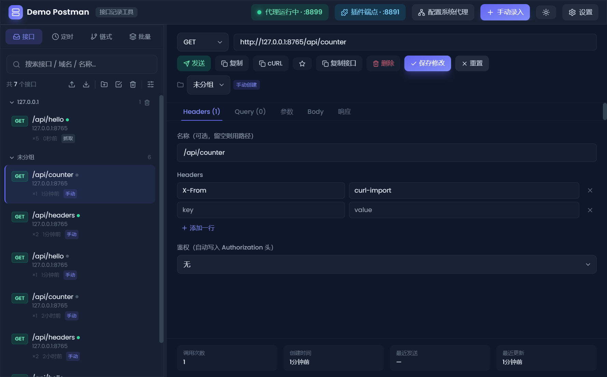
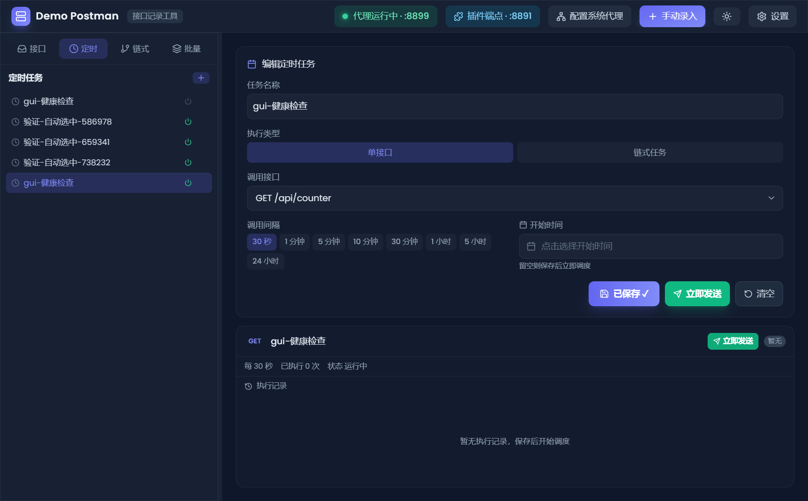
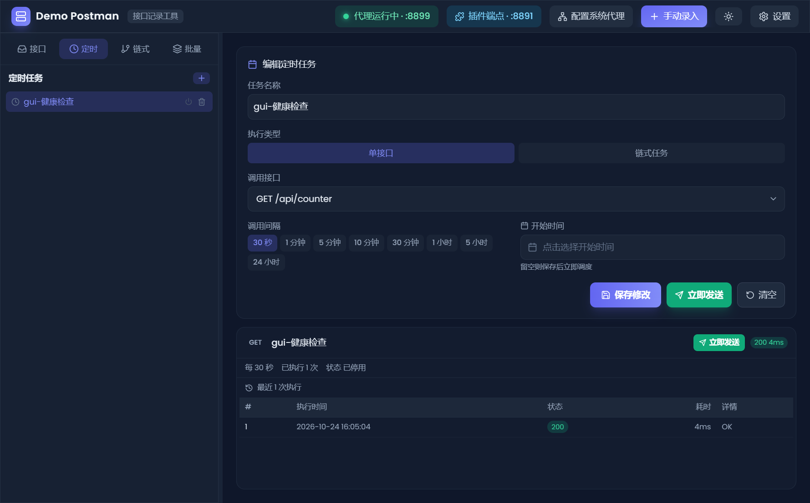
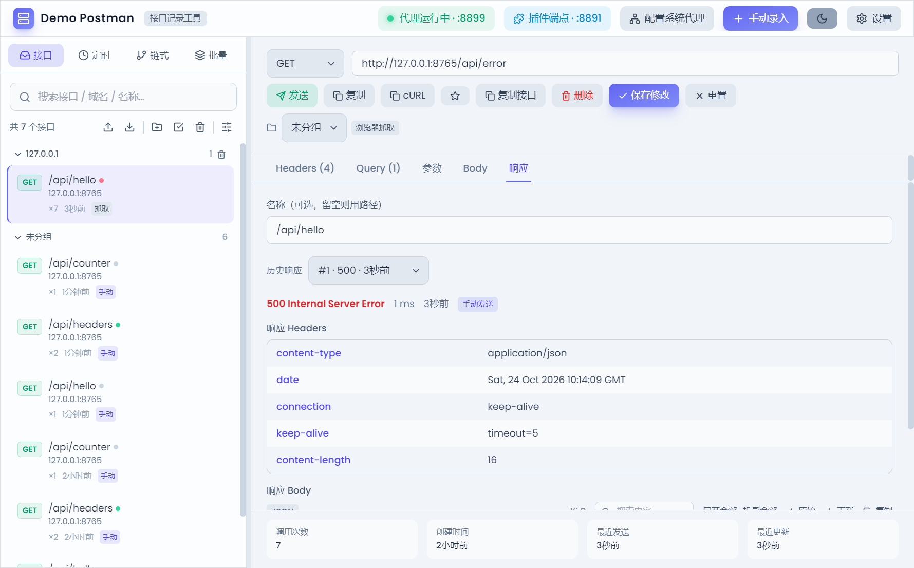
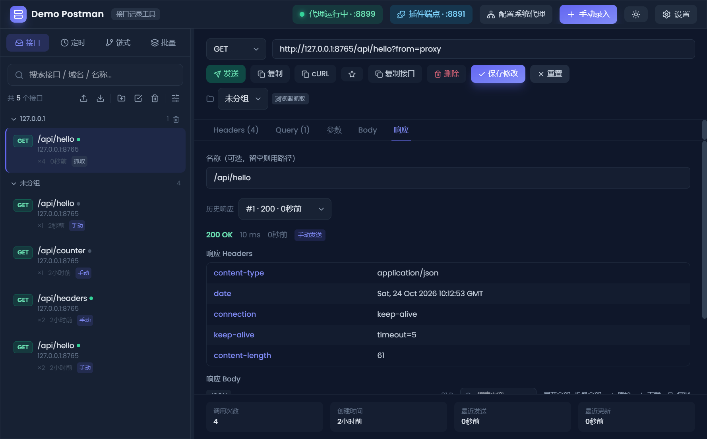
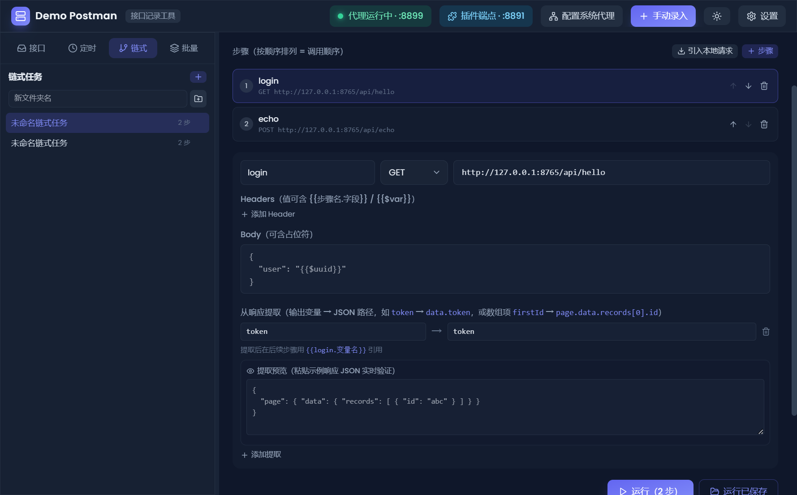
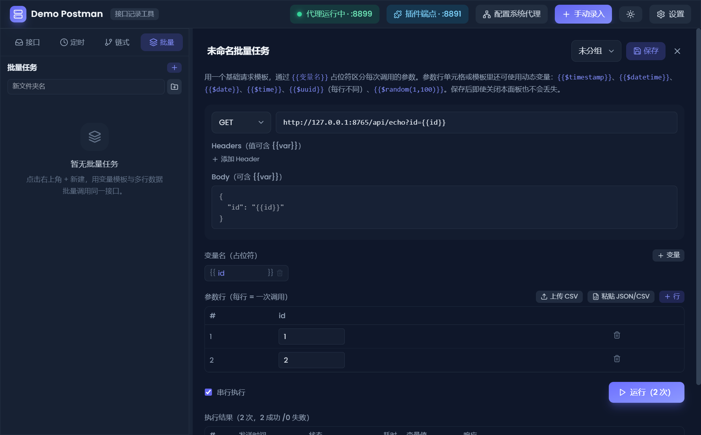
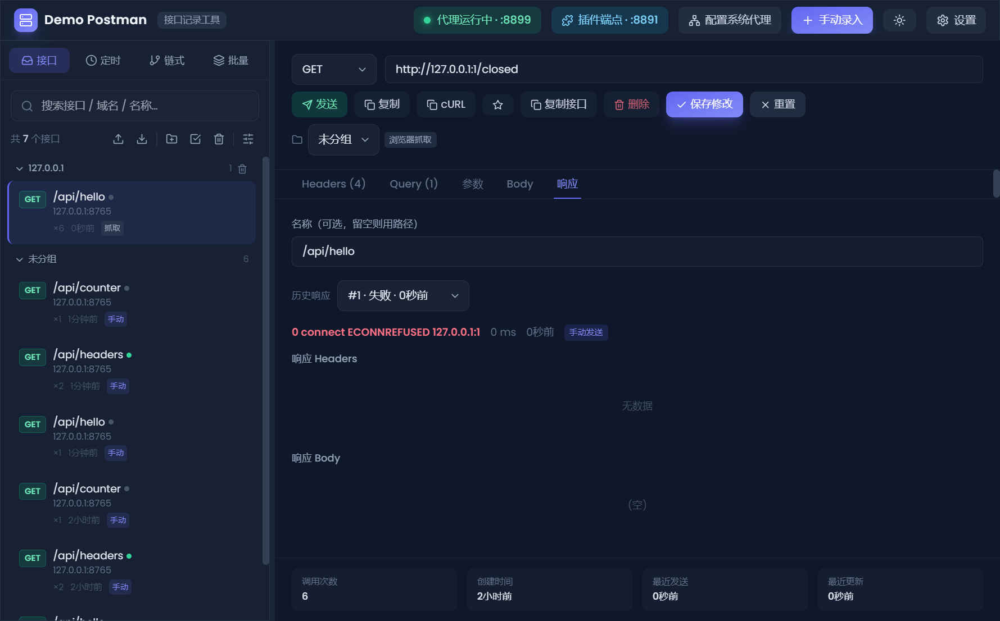

# Demo Postman 可用性测试报告与应用前景分析

- **测试日期**：2026-10-24
- **被测版本**：`main` 分支 `ecb7bfc`（与远程 `origin/main` 完全同步，工作区干净，即当前最新代码）
- **测试方式**：黑盒 GUI 测试 —— 通过 Playwright Electron 驱动真实应用窗口，仅模拟真实用户操作（点击、输入、下拉选择），配合 aria 无障碍快照（代码层只读验证）与逐点截图（视觉验证），并以独立测试目标服务的请求打点（`hits.json`）做服务端交叉验证
- **测试环境**：Windows 11 · Node v22.23.4 · Electron 31 · 生产构建（`npm run build` 后运行 `out/`）；应用数据目录隔离到 `gui-test-artifacts/electron-data`，未触碰真实用户数据
- **结果速览**：GUI 测试 **13/13 测试点通过，全程 0 控制台错误、0 崩溃**；发现 **1 个 P1 功能缺陷**（代理只监听 IPv6）、**2 个体验/视觉问题**；另有**单元测试框架"假绿"问题**（失败被吞掉）

---

## 一、环境准备说明（区分预置状态与测试行为）

1. `npm install`（545 包）、`npm run build`（1554 模块，构建成功）。
2. 启动独立目标服务 `gui-test-artifacts/test-server.js`（127.0.0.1:8765），提供 `/api/hello`（返回固定 token）、`/api/echo`（回显 body/头）、`/api/headers`（回显请求头）、`/api/counter`（计数）等端点，每 0.8s 落盘请求打点，作为"服务端真实收到什么"的独立证据。
3. 排查中发现应用捕获代理默认端口恰好也是 8899，为避免端口冲突，将目标服务从 8899 挪至 8765。
4. 测试中通过应用 UI 创建的数据（接口、链式、批量、定时任务）全部落在隔离数据目录，测试后可直接整体删除。

## 二、单元测试（npm test）

- 50 项断言中 48 项通过；**2 项代理捕获相关测试失败**（`connect ECONNREFUSED 127.0.0.1:19099 / 19077`）。
- **发现测试框架缺陷（假绿）**：`test/run.ts` 对每个用例的 `.catch` 只打印 `✗` 日志，不累计失败数、不设置非零退出码，结尾无条件打印"全部断言通过：核心 50 项 ✅"。CI 若依赖该脚本，失败会被完全掩盖。建议增加 `failed` 计数并 `process.exit(failed ? 1 : 0)`。
- 这 2 个"失败"后来被 GUI 测试证实**不是测试环境问题，而是产品真实缺陷**（见 3.1）。

## 三、GUI 黑盒测试结果

### 3.1 缺陷与问题清单

#### P1（功能缺陷）：捕获代理只监听 IPv6，按界面提示连接 127.0.0.1 会被拒绝

- **现象**：顶部代理徽标显示"代理运行中 · :8899"，但 `curl -x http://127.0.0.1:8899 ...` 返回 `Connection refused`；改用 `http://[::1]:8899` 则转发成功。空态引导文案明确让用户"将 HTTP 代理指向 **127.0.0.1:8899**"，照做必然失败（不回退 IPv4 的客户端全部中招）。
- **证据**：`netstat` 显示代理只监听 `[::1]:8899`（对照：插件端点正确绑定 `127.0.0.1:8891`）；单元测试 2 个 ECONNREFUSED 同因。
  
- **根因**：`src/main/proxy/captureProxy.ts:229` 调用 `proxy.listen({ port, sslCaDir })` 未传 `host`；`http-mitm-proxy` 内部默认 `host: "localhost"`，在本机被 Node 解析为 IPv6 `::1`。
- **修复建议**：显式传 `host: '127.0.0.1'`（一行改动）；同时把 `test/run.ts` 的失败计入退出码，让单测能暴露此问题。
- **说明**：通过 `[::1]` 走代理时，转发与捕获链路本身完全正常（目标服务收到请求、侧栏出现"抓取"来源记录并按域名自动分组），即修复绑定后该功能可用。

#### P2（体验问题）：定时任务创建后主区域空白 —— ✅ 已修复（见第六节）

- 创建成功后右侧详情区完全空白，不自动选中新任务，也没有"点击任务查看详情/历史"之类的空态提示；用户不知道下一步该做什么。点击左侧任务行后一切正常（编辑表单、执行状态"每 30 秒 已执行 1 次"、执行历史表格均完整渲染）。
  
  

#### P3（视觉问题）：浅色主题存在深色残留 —— ✅ 已修复（见第六节）

- 切换浅色主题后，顶栏/侧栏正常变浅，但详情面板与响应 Headers 表格仍残留大片深色行，明暗混杂。
  

#### 观察项（非缺陷，建议在文档中说明）

- 手动录入与代理抓取的同 `method+host+path` 记录**不互相合并**（分两条存放）。对"手动建集合不被抓取覆盖"是合理设计，但与 README"同一接口只保留一条记录"的表述有出入。
- 设置弹窗不响应 Esc，关闭按钮为纯图标无 accessible name（对键盘/读屏用户不友好）。

### 3.2 通过的测试点（13/13）

| # | 测试点 | 结果 | 关键证据 |
| --- | --- | --- | --- |
| T1 | 手动录入接口并保存（自动去重） | ✅ | 侧栏出现记录；保存不误发请求（服务端 +0） |
| T2 | 详情面板发送请求并查看响应 | ✅ | 200 OK · 8ms，响应体/头/调用次数正确渲染 |
| T3 | 编辑 Query/Header 后发送 | ✅ | 服务端回显 `X-Test: abc123` 与 `foo=bar` |
| T4 | cURL 一键导入 | ✅ | `解析并填充`正确回填方法/URL/Header |
| T5 | 链式请求两步工作流（提取→注入） | ✅ | 步骤1 提取 token，步骤2 Body `{{login.token}}` 成功注入（服务端 +2） |
| T6 | 批量调用（模板 + 变量行） | ✅ | "执行结果 2 次，2 成功/0 失败"；服务端按 id=1,2 各命中 1 次 |
| T7 | 定时任务创建（30 秒间隔） | ✅ | 任务入列并按周期调度（见 P2 体验问题） |
| T7b | 定时任务真实触发与停用 | ✅ | 服务端 42s 窗口内被调 1 次；执行历史 200/4ms；"点击停用"生效 |
| T8 | 代理自动捕获 HTTP 请求 | ✅* | 捕获链路正常（`*`附 P1 绑定缺陷） |
| T9 | 连接失败错误处理 | ✅ | 红色 `connect ECONNREFUSED` + 失败历史，不崩溃 |
| T9b | HTTP 500 错误处理 | ✅ | 红色 `500 Internal Server Error` 正确呈现 |
| T10 | 设置面板完整性 | ✅ | 自动分组/去重/严格 TLS/环境变量/数据目录齐全 |
| T11 | 明暗主题切换 | ✅ | 切换生效（`*`附 P3 残留问题） |

代表性截图：






### 3.3 稳定性与工程质量观察

- 全程（三轮完整回归 + 多次探针）**控制台错误与页面异常均为 0**，无崩溃、无白屏、无卡死。
- UI 无障碍标注整体优秀（aria 快照结构清晰，绝大部分控件有可访问名称），这使自动化测试非常顺畅——反过来说明前端工程质量较高。
- 响应区具备 JSON 树/原始切换、搜索、展开/折叠、下载、历史响应回看（`#1 · 500 · 3秒前`）、调用次数统计等细节，完成度超出"demo"预期。
- 数据持久化（隔离目录重启后链式/批量/定时/接口记录均在）、导入导出、文件夹分组等在快照与测试中均有体现。

## 四、应用前景分析

### 定位与差异化

这是一个"**抓包录制 + API 调试**"二合一的本地优先工具：代理/浏览器扩展自动录制接口 → 按 method+URL 去重 → 手动重放/编辑 → 链式工作流（JSONPath 提取传参）→ 批量数据驱动调用 → 定时调度。这条"录制-回放-编排"闭环是它与纯调试工具（Postman/Bruno）和纯抓包工具（Charles/Fiddler/mitmproxy）之间的差异点，且中文 UX 对国内开发者友好、数据全本地（无账号、无云同步，隐私与合规友好）。

### 竞争格局

- **Postman/Apifox**：功能全（协作、文档、Mock、测试），但重、且核心场景绑定账号云服务。本工具打不过它们的"全"，只能打"轻 + 本地 + 录制"。
- **Bruno**（爆火的开源 Postman 替代）已验证了"本地优先、git 友好、无账号"这条细分赛道有真实需求；本项目技术路线与之同向，但多了"自动录制"这张 Bruno 没有的牌。
- **mitmproxy/Charles**：抓包强，但"把抓到的接口立刻变成可编排的重放任务"这一步是断的——这正是本项目最有前景的粘合点（如：抓包 → 一键生成回归用例/定时巡检/mock 服务）。

### 主要风险

1. **稳定性与成熟度**：本次发现的 IPv4 绑定缺陷说明核心抓包路径缺少端到端回归保护（单测还是假绿的）；HTTPS 抓包需要安装信任 CA，本身有使用门槛。
2. **能力广度**：仅 HTTP/HTTPS，无 WebSocket/gRPC；无团队协作、无 Mock 服务、无断言/测试报告、无插件生态。
3. **合规/商标**："Postman"字样用于开源分发存在商标风险，建议更名。
4. **维护投入**：单人 demo 项目到可用产品的距离主要在测试覆盖、打包分发（当前仅 Windows portable）与文档。

### 结论

**有真实的应用前景，但定位应是"细分工具"而非"Postman 替代品"。** 当前完成度：核心功能 13/13 可用、稳定性零崩溃，可评为 **beta 级别的个人/小团队内部工具**（可用性 4/5，扣分在 P1 缺陷与打磨细节）。建议路线：

1. **立即**：修代理 host 绑定（一行）、修单测假绿（让回归真正生效）；
2. **短期**：定时/链式详情的空态引导、浅色主题适配、设置弹窗 Esc；
3. **中期**：把"录制 → 一键生成可重复执行的回归集/定时巡检"做深，作为对 Bruno/mitmproxy 的差异化卖点；开源并更名，走社区路线。

## 六、修复记录（2026-10-24，针对 3.1 节 P2/P3）

改动 3 个文件（`git diff` 可查，未提交）：

1. **P3 浅色主题残留（根因修复）** — `src/renderer/src/index.css`
   - 根因：手写覆盖选择器 `.theme-light .bg-\[#0F172A\]` 少转义了 `#`。CSS 解析时 `#` 会开启 ID 选择器，整条规则被拆成"类 `bg-[` + ID 选择器"而永远匹配不上，导致 `main` 根节点的深色背景在浅色主题下未被替换（`bg-transparent` 的表格行透出深底，形成明暗交替）。Tailwind 实际生成的类名为 `.bg-\[\#0F172A\]`。已改为 `\[\#0F172A\]`。
   - 同时按既有取值约定补齐 6 组缺失覆盖：`bg-slate-900/95`（日期选择/搜索浮层）、`bg-slate-900/50`（链式代码块）、`bg-slate-900/40`、`/30`（展开详情行/结果容器）、`bg-slate-800/95`（粘性表头、Toast）、`border-slate-600/60` 与 `border-slate-500`、`hover:bg-slate-700/40`。弹窗遮罩 `bg-slate-900/70` 为标准深色 scrim，刻意不覆盖。
   - 验证：只读扫描 `main` 及其全部子元素的计算样式，浅色下**深色背景元素数为 0**；设置弹窗浅色渲染正常（`gui-test-artifacts/fix_B_light_detail.png`、`fix_B_light_settings.png`）。

2. **P2 定时任务创建后空白** — `src/renderer/src/components/SchedulePanel.tsx` + `src/renderer/src/App.tsx`
   - 新增 `onSelect` 回调：创建成功后不再收起表单留下空白，而是调用 `editSchedule(config.id)` 保持编辑态并加载执行历史，同时经 `App.handleSelect('schedules', id)` 同步左侧栏高亮（与链式面板既有交互模式一致）。
   - 验证：创建后表单呈"编辑定时任务"、概要区显示"每 30 秒 · 状态 运行中"、执行记录区可见、左侧栏新任务高亮（`gui-test-artifacts/fix_A_after_create.png`）。

3. **回归**：修复后重跑全部 13 项 GUI 测试，**13/13 通过、0 控制台错误**（`gui-test-artifacts/gui-test-run2.log`）。应用整体构建通过，全流程无回归。

> 未处理：P1 代理 IPv4 绑定缺陷与单测假绿问题（见 3.1 与第二节），待后续单独修复。

## 七、附录：复现方式

```bash
npm install && npm run build
cd gui-test-artifacts
node test-server.js &        # 本地目标服务 :8765
node gui-test.js             # GUI 黑盒主脚本（13 测试点，约 2 分钟）
node probe-proxy.js          # 代理 IPv4/IPv6 绑定探针
node supplement.js           # 定时任务详情补充验证
```

产物：`results.json`（结构化结果）、各测试点截图与 aria 快照、`hits.json`（服务端打点）。测试代码与产物均未纳入 git 跟踪，可自行删除。
